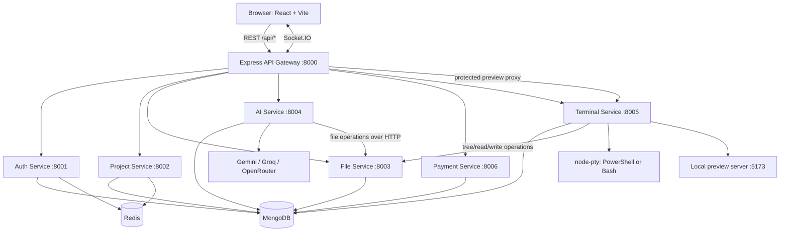
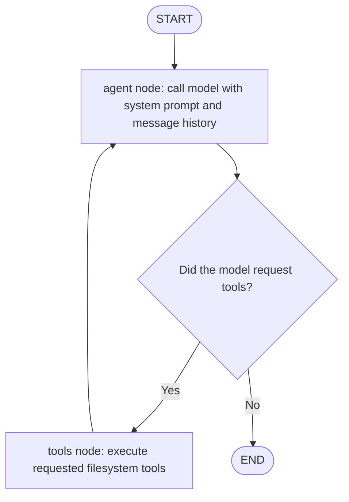
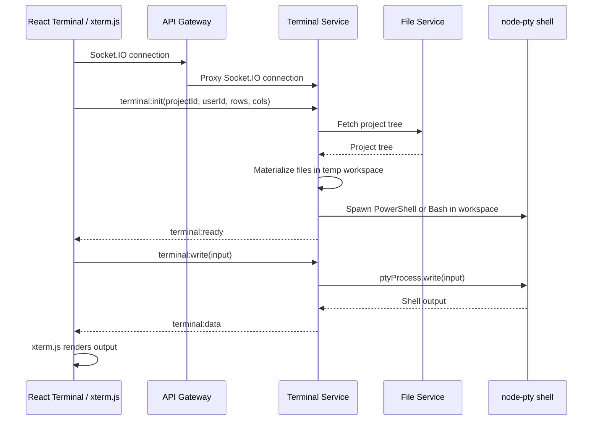
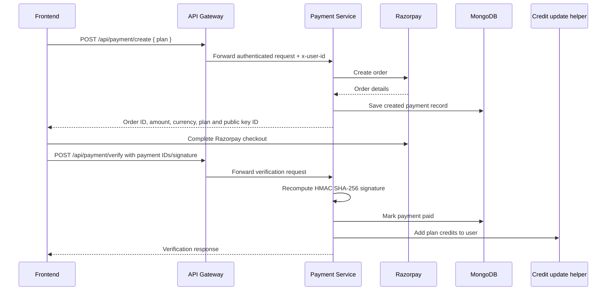
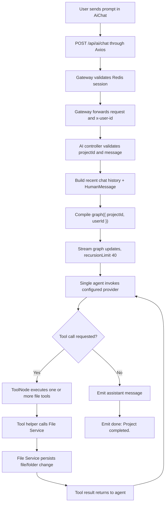
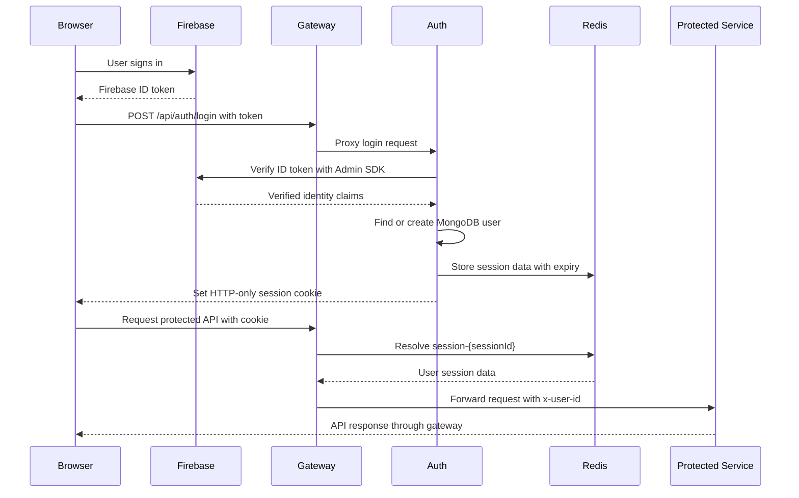

# VertexAI — AI-Powered Browser Code Editor

VertexAI is a browser-based coding workspace that combines a project/file explorer, Monaco editor, project preview, interactive terminal, and an AI coding assistant. The backend is split into independently runnable Node.js services behind an Express API gateway.

> **Documentation source and implementation status**
>
> This README was prepared by reviewing the supplied backend and frontend ZIP archives. The source archives are treated as the primary description of the implementation represented here. The linked Notion pages for **AI Service** and **Terminal Service** contain earlier implementation notes; they are useful historical context, but they do **not** describe every detail of the newer code in the supplied archives. In particular, the AI implementation documented below is the single-agent graph in the supplied source, and the terminal implementation includes filesystem synchronization in both directions. Do not use the older Notion descriptions as proof of current behavior.
>
> This README describes the snapshot that was reviewed. It does not claim that the application has passed a fresh end-to-end test or that every deployment environment is configured.

## Contents

- [Product capabilities](#product-capabilities)
- [Technology stack](#technology-stack)
- [System architecture](#system-architecture)
- [Repository layout](#repository-layout)
- [Frontend](#frontend)
- [Backend services](#backend-services)
- [AI request lifecycle](#ai-request-lifecycle)
- [Terminal and workspace synchronization](#terminal-and-workspace-synchronization)
- [Authentication and session flow](#authentication-and-session-flow)
- [Payments and credits](#payments-and-credits)
- [Local development](#local-development)
- [Environment configuration](#environment-configuration)
- [Deployment notes](#deployment-notes)
- [Known limitations and security considerations](#known-limitations-and-security-considerations)
- [Historical documentation note](#historical-documentation-note)

## Product capabilities

The reviewed frontend and backend source contain these product areas:

- User sign-in through Firebase Authentication, with backend ID-token verification.
- A dashboard for creating, listing, opening, starring, and deleting projects.
- A project workspace with a file explorer and tabbed code editor.
- Monaco-based code editing.
- A preview panel that builds an HTML document from project files and renders it in a sandboxed iframe.
- An AI chat panel that can inspect and modify project files through backend tools.
- A browser terminal powered by xterm.js, Socket.IO, and node-pty.
- Synchronization between the terminal's local workspace and the File Service's stored project tree.
- Paid plans backed by Razorpay order creation and payment-signature verification, with credits added to the user's account.

The preview implementation in the reviewed source is a lightweight HTML/CSS/JavaScript `srcDoc` preview. It is not a general-purpose runtime for every framework or language.

## Technology stack

| Area | Technologies found in the supplied source | Responsibility |
|---|---|---|
| Frontend | React 19, Vite 8, React Router, Tailwind CSS 4 | Browser application and UI |
| State | Redux Toolkit, React Redux | User and project state |
| Code editor | `@monaco-editor/react` | Source editing |
| Terminal UI | `@xterm/xterm`, `@xterm/addon-fit` | Terminal rendering, input, sizing |
| Realtime client | Socket.IO Client | Browser-to-terminal events |
| Backend runtime | Node.js, ECMAScript modules | Service runtime |
| HTTP framework | Express 5 | APIs and middleware |
| API gateway | `express-http-proxy`, `http-proxy` | HTTP routing and Socket.IO/preview proxying |
| Database | MongoDB, Mongoose | Users, projects, files, payment records |
| Session/cache | Redis, ioredis | Session lookup and project-list caching |
| Authentication | Firebase client SDK, Firebase Admin SDK, HTTP-only cookie | Identity verification and application session |
| AI orchestration | LangGraph.js, LangChain Core | Stateful tool-calling graph |
| AI providers | Google Gemini, Groq, OpenRouter | Model inference and provider fallback |
| AI validation | Zod 4 | Tool argument schemas |
| Terminal runtime | node-pty | Interactive PowerShell/Bash process |
| Payments | Razorpay Node SDK | Order creation and payment verification |
| Packaging | Dockerfiles per service | Container images |
| Local infrastructure | Docker Compose (Redis service in supplied file) | Local Redis container |

## System architecture

### High-level component view



The gateway is the browser-facing API boundary. The services own their respective business logic. The AI and Terminal services both communicate with the File Service rather than directly modifying the File Service's MongoDB records.

### Service ports in the supplied source

| Component | Default port | Gateway route / connection |
|---|---:|---|
| API Gateway | `8000` | Browser-facing HTTP API |
| Auth Service | `8001` | `/api/auth` |
| Project Service | `8002` | `/api/project` |
| File Service | `8003` | `/api/file` |
| AI Service | `8004` | `/api/ai` |
| Terminal Service | `8005` | `/api/terminal`, `/preview`, Socket.IO proxy |
| Payment Service | `8006` | `/api/payment` |
| Vite preview target | `5173` | Proxied by Terminal Service in the reviewed code |
| Redis | `6379` | Shared Redis connection |

Ports are defaults from the source, not a guarantee that a deployment uses these exact values. Environment variables can override service ports and service URLs.

## Repository layout

The uploaded archives represent this structure (dependency folders, build output, environment files, and credential files are intentionally omitted here):

```text
vertexAI/
├── backend/
│   ├── gateway/
│   │   ├── controllers/
│   │   ├── middleware/
│   │   ├── utils/
│   │   └── index.js
│   ├── services/
│   │   ├── auth/
│   │   ├── project/
│   │   ├── file/
│   │   ├── ai/
│   │   ├── terminal/
│   │   └── payment/
│   ├── shared/
│   │   └── redis/
│   ├── docker-compose.yml
│   └── package.json
└── frontend/
    ├── public/
    ├── src/
    │   ├── components/
    │   ├── features/
    │   ├── pages/
    │   ├── redux/
    │   └── utils/
    ├── firebase.js
    ├── package.json
    └── vite.config.js
```

## Frontend

The frontend is a React/Vite single-page application.

### Main routes

| Route | Page | Purpose |
|---|---|---|
| `/` | `Dashboard.jsx` | Project dashboard and project actions |
| `/project/:id` | `ProjectPage.jsx` | Main coding workspace |
| `/plan` | `Plan.jsx` | Plan selection and payment flow |

`App.jsx` requests the current user through the `me` feature when the application mounts and stores the returned user in Redux.

### State management

The Redux store combines the user and project slices:

- `userSlice.js` stores the current user/session-facing data.
- `projectSlice.js` stores the current project.
- `features/` contains API functions for authentication, user lookup, project operations, file operations, AI chat, and payments.
- `utils/axios.js` creates the shared Axios client using `VITE_SERVER_URL` and `withCredentials: true`, allowing the browser to send the session cookie to the gateway.

### Workspace composition

`ProjectPage.jsx` composes the IDE interface:

- `TopBar` — workspace-level controls.
- `ActivityBar` — switches workspace panels.
- `Explorer` and `Folder` — project file/folder navigation.
- `Editor` — Monaco editor and open-file tabs.
- `Preview` — HTML/CSS/JavaScript preview.
- `BottomPanel` and `Terminal` — terminal panel.
- `AiChat` — AI coding assistant.

The page loads project details and the file tree when the project route changes. Selecting a file opens it in the editor; AI and terminal changes can request a tree refresh.

### Preview behavior

The reviewed `Preview.jsx` walks the supplied tree and extracts:

- `index.html`
- a CSS file ending in `.css`
- a JavaScript file ending in `.js`

It injects the CSS and JavaScript into the HTML and renders the result through an iframe using `srcDoc` and a sandbox attribute. If no `index.html` exists, it displays an explanatory placeholder.

This preview should be understood as a basic static web preview. It does not install packages, run a Vite build, or execute arbitrary project frameworks by itself. A separate preview proxy path exists in the backend; deployment and runtime configuration must be checked before treating it as a complete hosted preview environment.

## Backend services

### 1. API Gateway

**Location:** `backend/gateway/`

The gateway creates the HTTP server and applies:

- CORS using the configured frontend origin, with credentials enabled.
- Cookie parsing.
- Morgan request logging.
- Session protection middleware for protected routes.
- HTTP proxying to internal services.
- A WebSocket upgrade proxy for Socket.IO traffic to the Terminal Service.

Route mapping in the reviewed gateway:

| Public path | Downstream |
|---|---|
| `/api/auth/*` | Auth Service |
| `/api/project/*` | Project Service, protected |
| `/api/file/*` | File Service, protected |
| `/api/ai/*` | AI Service, protected |
| `/api/terminal/*` | Terminal Service, protected |
| `/api/payment/*` | Payment Service, protected |
| `/api/me` | Gateway current-user handler, protected |
| `/preview/*` | Terminal Service preview proxy, protected |
| `/socket.io/*` | Terminal Service Socket.IO proxy |

`proxyWithHeader.js` forwards the authenticated user ID as `x-user-id` when `req.user` is present. The gateway's `protect` middleware reads the `session` cookie, looks up `session-${sessionId}` in Redis, parses the stored user data, and attaches it to `req.user`.

The Socket.IO upgrade proxy is implemented separately from the ordinary Express route middleware. Review its authentication and authorization behavior carefully before exposing it publicly; the terminal client also sends `userId` during terminal initialization.

### 2. Auth Service

**Location:** `backend/services/auth/`

The Auth Service:

1. Receives a Firebase ID token at `POST /login`.
2. Verifies the token using Firebase Admin `verifyIdToken`.
3. Finds or creates a MongoDB user using the Firebase UID.
4. Creates a random session ID.
5. Stores session data in Redis with a seven-day expiry.
6. Sets the session ID in an HTTP-only cookie.
7. Provides logout and credit adjustment endpoints.

Routes in the reviewed source:

| Method | Path | Purpose |
|---|---|---|
| `POST` | `/login` | Verify Firebase token and create application session |
| `GET` | `/logout` | Delete session data and clear cookie |
| `POST` | `/user/deduct-credits` | Deduct user credits |
| `POST` | `/user/add-credits` | Add user credits |

The application session is distinct from the Firebase ID token. Firebase establishes the user's identity; Redis holds the application's session lookup used by the gateway.

### 3. Project Service

**Location:** `backend/services/project/`

The Project Service manages project metadata in MongoDB. The controller scopes project queries by the `x-user-id` supplied by the gateway.

Routes in the reviewed source:

| Method | Path | Purpose |
|---|---|---|
| `POST` | `/` | Create a project |
| `GET` | `/` | List the user's projects |
| `GET` | `/starred` | List starred projects |
| `GET` | `/:id` | Fetch one owned project and update its last-opened time |
| `PATCH` | `/:id` | Toggle project starred state |
| `DELETE` | `/:id` | Delete an owned project |

Redis caches the project list and starred-project list. Create, star/unstar, and delete operations invalidate relevant cache keys. The project controller checks ownership when fetching, starring, and deleting projects.

### 4. File Service

**Location:** `backend/services/file/`

The File Service is the persistence boundary for project files and folders. It stores file/folder records in MongoDB and constructs nested project trees.

Routes in the reviewed source:

| Method | Path | Purpose |
|---|---|---|
| `POST` | `/create-root-folder` | Create a project root folder |
| `POST` | `/create-folder` | Create a child folder |
| `POST` | `/create-file` | Create a file |
| `POST` | `/update/:id` | Update a file |
| `DELETE` | `/:id` | Delete a file/folder resource |
| `GET` | `/tree/:projectId` | Retrieve a project's tree |
| `GET` | `/:id` | Retrieve one file/resource |

`buildTree.js` is responsible for building the nested representation used by the explorer, AI tools, and Terminal Service. The File Service is used by both AI tool helpers and the terminal synchronization code, keeping file persistence behind one service API.

### 5. AI Service

**Location:** `backend/services/ai/`

**Important: the AI Service described here is the newer source snapshot in the supplied ZIP, not the older AI Service implementation described in the Notion page.**

The current reviewed graph is a **single tool-calling coding agent**, not the proposed supervisor/planner/coder/reviewer multi-agent workflow.

#### Current graph structure

`graph.js` builds a LangGraph `StateGraph` using `MessagesAnnotation`:



The graph has two nodes:

- `agent` — invokes the configured fallback model with the system prompt and current message state.
- `tools` — a LangGraph `ToolNode` that executes the tool calls.

The conditional edge routes from `agent` to `tools` when the last AI message contains tool calls. Otherwise, the graph ends. Tool results flow back to the agent so it can continue the task.

The graph is compiled per `graph({ projectId, userId })` call. The project and user identifiers are bound into the tools by the application rather than requested from the model.

#### Six filesystem tools

`graph/tools.js` defines six tools:

| Tool | Purpose |
|---|---|
| `get_tree` | Inspect the project structure |
| `get_file` | Read a file by ID |
| `create_folder` | Create a folder |
| `create_file` | Create a file |
| `update_file` | Update a file |
| `delete_file` | Delete a file |

The tool schemas use Zod. The tool implementations call the AI service's File Service HTTP helpers in `utils/fetchFileAPIs.js`. The helpers pass the user ID in the `x-user-id` header and send the actual operation to the File Service.

The system prompt instructs the model to inspect the tree, use exact IDs, create parent folders before files, read before updates/deletes where required, avoid duplicate operations, and complete the requested project changes. These instructions guide the model; they do not replace server-side authorization or validation.

#### Model provider fallback

`utils/llm.js` supports providers configured in `AI_PROVIDER_ORDER`. The default order in the reviewed code is:

1. Gemini
2. Groq
3. OpenRouter

A provider is included only when its API key is configured. Each provider model is bound to the same filesystem tools. The wrapper classifies provider failures, tracks provider cooldown state in process memory, and can attempt another eligible provider for retryable failures. It also records usage/fallback metrics in logs.

Provider/model defaults in the reviewed code:

| Provider | Default model | API key environment variables |
|---|---|---|
| Gemini | `gemini-2.5-flash` | `GOOGLE_API_KEY` or `GEMINI_API_KEY` |
| Groq | `openai/gpt-oss-120b` | `GROQ_API_KEY` |
| OpenRouter | `openai/gpt-4o-mini` | `OPENROUTER_API_KEY` |

Model names can be overridden using the corresponding `*_MODEL` variables. The fallback order can be overridden with `AI_PROVIDER_ORDER`.

Provider health/cooldown state is held in a JavaScript `Map`, so it is local to one running AI Service process. It is not a distributed provider-health registry shared by multiple replicas.

#### AI chat API and SSE

The AI route exposes `POST /chat`. The controller accepts `projectId`, `message`, and optional `history`, obtains the user ID from the gateway-injected `x-user-id` header, and constructs the LangGraph input as `{ messages }`.

The controller keeps the latest six valid user/assistant history entries, appends the new user message, and streams graph updates with:

- `streamMode: "updates"`
- `recursionLimit: 40`

The response uses Server-Sent Events (SSE). Event names emitted by the reviewed controller include:

| Event | Meaning |
|---|---|
| `start` | AI request has started |
| `tool_start` | The agent requested a tool operation |
| `message` | Assistant text content |
| `file_created` | File creation result surfaced from tool output |
| `folder_created` | Folder creation result surfaced from tool output |
| `file_updated` | File update result surfaced from tool output |
| `file_deleted` | File deletion result surfaced from tool output |
| `done` | Graph finished; the completion text is `Project completed.` |
| `error` | An error occurred after streaming began |

The controller also deducts 10 credits for a chat request through the credit helper. Verify the desired billing policy and failure/refund behavior before production use; the reviewed flow does not document a complete transactional billing/refund system.

### 6. Terminal Service

**Location:** `backend/services/terminal/`

**Important: the Terminal Service described here is the newer source snapshot in the supplied ZIP, not the older one-way synchronization description in the Notion page.**

The current reviewed Terminal Service combines:

- Express HTTP server.
- Socket.IO server.
- node-pty.
- A per-socket in-memory session map.
- A temporary project workspace under the operating system's temp directory.
- File Service API calls.
- Filesystem watching and synchronization in both directions.
- A preview proxy targeting a local development server.

#### Terminal lifecycle



The frontend uses xterm.js and FitAddon. It sends terminal input over `terminal:write`, receives `terminal:data`, sends dimensions through `terminal:resize`, and listens for `terminal:ready`. The backend stores a session keyed by `socket.id`, associating the socket with its project workspace and PTY process.

#### Bidirectional file synchronization

The reviewed Terminal Service goes beyond the older Notion description:

1. On `terminal:init`, it fetches the project tree from the File Service and writes the tree into a local temporary workspace.
2. A filesystem watcher observes changes made by terminal commands and schedules synchronization back to the File Service.
3. The sync logic detects created, updated, renamed, and deleted entries and calls the File Service APIs.
4. A periodic database-to-workspace sync checks for changes made outside the terminal (for example, through the editor or AI tools) and updates the local workspace.
5. After a successful terminal-originated sync, the service emits `terminal:files-changed` so the frontend can refresh its tree.

The service ignores common generated/build directories such as `node_modules`, `.git`, `dist`, and `build` during workspace watching/synchronization. The exact behavior should be validated against the current `TERMINAL_FILE_SYNC.md` and implementation before changing sync rules.

#### Preview proxy

The Terminal Service exposes a `/preview` HTTP proxy path. The gateway protects and forwards the preview request with the user ID. The Terminal Service extracts the project ID, asks the File Service for the project's tree as an access check, and proxies the request to `http://127.0.0.1:5173`.

This implies a local preview process/server must actually be available at that target for the proxy to return a working app. The reviewed source does not, by itself, establish how that preview process is created, supervised, isolated, or mapped to multiple projects. Treat this as a deployment/runtime dependency that needs verification.

### 7. Payment Service

**Location:** `backend/services/payment/`

The Payment Service integrates with Razorpay.

The reviewed controller defines two plans:

| Plan key | Display name | Amount | Credits |
|---|---|---:|---:|
| `pro` | Pro | ₹299 | 500 |
| `team` | Team | ₹799 | 2,000 |

Amounts are represented in paise in the source (`29900` and `79900`).

Payment flow:



The verification endpoint checks the order record, rejects already-paid records, recomputes the HMAC SHA-256 signature using the Razorpay key secret, compares it with the supplied signature, marks the payment as paid, and calls the credit update helper.

**Production review required:** payment verification and credit granting must be made robust against concurrent/replayed requests and partial failures. The reviewed flow marks the payment as paid before calling the credit helper, and the credit update is not shown as part of a MongoDB transaction with the payment status update. The code also logs signature values; sensitive payment verification material should not be written to logs. Use Razorpay's current recommended server-side verification and webhook/reconciliation guidance before production launch.

## AI request lifecycle

The main AI flow from the browser to persisted project files is:



The graph is responsible for reasoning and tool orchestration. The File Service remains responsible for persistence. The controller translates graph update chunks into the SSE event contract consumed by the frontend.

## Terminal and workspace synchronization

The terminal is a separate execution environment from the browser editor:

- xterm.js is the terminal UI; it does not execute shell commands.
- Socket.IO transports terminal input/output events.
- node-pty owns the interactive shell process.
- The Terminal Service materializes the project's stored tree into a local workspace.
- The File Service remains the persisted project file store.
- Filesystem watching and periodic synchronization keep the local workspace and stored tree aligned.

This architecture allows commands such as package installation or development scripts to run in a real shell process, subject to the environment in which the Terminal Service is deployed.

## Authentication and session flow



The gateway's protected middleware uses the session cookie and Redis record to attach the user to the request. Downstream services receive the user ID through an internal header. Services must still enforce ownership/authorization for the resources they expose; a user ID header is context passed by the gateway, not a substitute for a trusted service boundary.

## Local development

The following is a starting point based on the folder structure and package scripts in the supplied archives. It is not a claim that every service has been freshly tested together.

### Prerequisites

- Node.js version compatible with the package versions in the lockfiles.
- npm.
- MongoDB connection.
- Redis.
- Firebase project and Admin credentials.
- AI provider API key(s).
- Razorpay test credentials if exercising payments.
- A platform/toolchain compatible with `node-pty` native dependencies.

### 1. Start Redis

The supplied `backend/docker-compose.yml` defines Redis only:

```bash
cd backend
docker compose up -d redis
```

### 2. Configure environment variables

Create the required local environment files for the frontend, gateway, and each backend service. See [Environment configuration](#environment-configuration). Never commit real `.env` files or Firebase service-account credentials.

### 3. Install dependencies

Install each service's dependencies from its own directory, for example:

```bash
cd backend/gateway
npm install

cd ../services/auth
npm install

cd ../project
npm install
```

Repeat for `file`, `ai`, `terminal`, and `payment`. Then install frontend dependencies:

```bash
cd ../../../frontend
npm install
```

Use the correct relative path for your current shell directory; the commands above are examples of the individual package locations, not a monorepo-wide workspace command.

### 4. Start backend processes

Each backend package exposes `start` and `dev` scripts. Start Redis and MongoDB first, then start the services in separate terminals. A typical local port layout is:

- Gateway: `8000`
- Auth: `8001`
- Project: `8002`
- File: `8003`
- AI: `8004`
- Terminal: `8005`
- Payment: `8006`

The gateway's service URL variables should point to the corresponding service URLs. When using Docker networking, use service DNS names rather than `localhost` for container-to-container communication.

### 5. Start the frontend

```bash
cd frontend
npm run dev
```

The frontend uses `VITE_SERVER_URL` for the gateway API base URL. The terminal component also reads `VITE_TERMINAL_SERVICE_URL`; configure it consistently with the gateway/Terminal Service topology used in your environment.

### 6. Build and lint the frontend

```bash
cd frontend
npm run build
npm run lint
```

The supplied backend root package does not define a real automated test suite; its `test` script currently exits with an “Error: no test specified” message. Individual services expose `start` and `dev`, but no service-level automated test scripts were present in the reviewed package manifests.

## Environment configuration

The following names were found by scanning the supplied source. Some are optional or have code defaults; exact requirements depend on which services and features are started.

| Variable | Used by | Purpose |
|---|---|---|
| `PORT` | Backend services | HTTP listening port |
| `FRONTEND_URL` | Gateway | Allowed browser origin for CORS |
| `AUTH_SERVICE` | Gateway | Auth Service base URL |
| `PROJECT_SERVICE` | Gateway | Project Service base URL |
| `FILE_SERVICE` | Gateway | File Service base URL |
| `AI_SERVICE` | Gateway | AI Service base URL |
| `TERMINAL_SERVICE` | Gateway | Terminal Service base URL |
| `PAYMENT_SERVICE` | Gateway | Payment Service base URL |
| `MONGODB_URI` | Database-backed services | MongoDB connection string |
| `REDIS_URL` | Shared Redis client | Redis connection string |
| `FILE_SERVICE_URL` | AI and Terminal services | File Service base URL |
| `GOOGLE_API_KEY` / `GEMINI_API_KEY` | AI Service | Gemini credentials |
| `GEMINI_MODEL` | AI Service | Optional Gemini model override |
| `GROQ_API_KEY` | AI Service | Groq credentials |
| `GROQ_MODEL` | AI Service | Optional Groq model override |
| `OPENROUTER_API_KEY` | AI Service | OpenRouter credentials |
| `OPENROUTER_MODEL` | AI Service | Optional OpenRouter model override |
| `AI_PROVIDER_ORDER` | AI Service | Comma-separated provider fallback order |
| `RAZORPAY_KEY_ID` | Payment Service | Razorpay public key ID used for checkout |
| `RAZORPAY_KEY_SECRET` | Payment Service | Server-side Razorpay secret |
| `NODE_ENV` | Auth Service | Cookie security/same-site behavior |
| `VITE_SERVER_URL` | Frontend | API Gateway base URL |
| `VITE_TERMINAL_SERVICE_URL` | Frontend | Terminal Socket.IO connection URL |

Firebase Admin initialization imports a service-account JSON file in the reviewed source. Provide that credential securely at runtime and do not commit it. The frontend Firebase configuration is in `frontend/firebase.js`; review its public Firebase project configuration and ensure the Firebase project's authorized domains and security rules are correct.

Do not copy secret values into this README. Configure secrets through local untracked environment files for development and an appropriate secrets manager/runtime secret injection mechanism in production.

## Deployment notes

Each backend service directory includes a Dockerfile in the supplied snapshot. The backend is organized as multiple separately runnable processes, so deployment requires:

- One deployable container/service for the gateway.
- One for each backend microservice.
- Reachable MongoDB and Redis instances.
- Correct internal service URLs and externally reachable gateway configuration.
- Secure Firebase Admin credentials and AI/payment secrets.
- Correct port mappings and health checks.
- Socket.IO WebSocket upgrade support through the gateway/load balancer for terminal sessions.
- A deliberate strategy for the Terminal Service's writable workspace and preview process.

The Terminal Service uses local temporary storage and in-memory socket-to-PTY sessions. A container restart or task replacement can interrupt active terminal sessions. Multiple replicas do not automatically share PTY sessions or local workspaces. Do not scale the Terminal Service horizontally without session affinity/routing and workspace/session lifecycle design.

The preview proxy targets `127.0.0.1:5173` inside the Terminal Service process environment. Ensure the intended preview server is actually running and safely isolated. A single fixed local port is not, by itself, a multi-tenant preview architecture.

The supplied Compose file starts Redis only; it is not a complete local stack definition for all services.

## Known limitations and security considerations

These are important review findings from the supplied source snapshot. They should be treated as follow-up engineering work, not hidden behind marketing claims.

### Authentication and trust boundaries

- The gateway's normal protected HTTP routes use a Redis-backed session cookie. The Socket.IO upgrade proxy is configured separately; confirm that socket connections are authenticated and that the Terminal Service verifies the user's authorization for the requested project before spawning a shell.
- The terminal initialization payload includes `userId`. Client-provided identity values must never be trusted without server-side authentication and authorization.
- Downstream `x-user-id` headers are only trustworthy when internal services cannot be reached or spoofed by untrusted clients and the gateway controls the header.
- Cookie settings differ between development and production. Production requires HTTPS and a carefully configured CORS origin, cookie domain, `SameSite`, and CSRF strategy.
- Logout deletes the current session key and clears the cookie. Review cleanup of the corresponding `user-session-{userId}` mapping and session rotation/revocation behavior.

### Terminal isolation and filesystem safety

- The Terminal Service launches a real shell process. A project working directory is not a security sandbox.
- Shell commands run with the operating-system permissions of the Terminal Service container/process. Use container isolation, least-privilege users, resource limits, filesystem boundaries, network egress controls, and process limits before exposing this capability to untrusted users.
- Validate project IDs, tree structures, and fully resolved filesystem paths. Rejecting path separators in individual names is not a complete path traversal defense.
- PTY sessions are stored in a process-local `Map`. They are not durable and are not shared across replicas.
- Killing a PTY does not necessarily terminate every child/grandchild process started by the shell.
- Temporary workspace cleanup and retention need an explicit lifecycle policy.
- Filesystem watcher behavior, periodic sync races, rename detection, and simultaneous editor/terminal writes need stress testing. Conflicting concurrent changes can otherwise overwrite user work.
- The preview target is a local fixed port; multi-project preview isolation and process supervision are not established by the reviewed source.

### AI reliability and cost controls

- The current graph is a single agent with six tools. A supervisor/planner/coder/reviewer architecture is not implemented in the supplied `graph.js`.
- The system prompt guides tool use but does not guarantee correct code, complete output, or successful execution.
- Provider fallback is best-effort. Providers may have different model capabilities, tool-call formats, quotas, context windows, and availability.
- Provider health/cooldown state is process-local and resets when the AI Service restarts.
- The controller deducts 10 credits for an AI request. Verify when deductions occur, what happens on failed generations, and whether refunds or idempotency are needed.
- The graph uses `recursionLimit: 40`; complex requests can still hit provider limits, tool-call errors, or the graph limit.
- The AI service does not execute generated code as part of its graph's final check; its system prompt describes a mental review rather than a separate runtime test/reviewer agent.
- User-supplied prompts and project files are untrusted input. Tool descriptions and system prompts are not a security boundary.

### Payments and billing

- The reviewed payment flow should be hardened against concurrent verification, replay, and partial failure between marking a payment paid and granting credits.
- Signature material should not be logged. Keep Razorpay secrets server-side.
- Add reconciliation/webhook handling and operational monitoring according to the payment provider's current recommendations.
- Validate plan IDs, amounts, currency, user ownership, and payment state on the server; never trust client-provided credit quantities.

### Operations and observability

- The supplied backend package manifests do not define a working automated test suite.
- Health endpoints should distinguish process liveness from readiness of MongoDB, Redis, File Service, provider APIs, PTY capability, and preview runtime.
- Add structured logs, request correlation IDs, metrics, alerting, and explicit timeouts/retry policies for service-to-service calls.
- Confirm startup ordering and readiness: several services start listening and initiate database connection in the listen callback or without awaiting readiness.
- Keep dependency versions and lockfiles synchronized, and regularly audit dependencies and container base images.

## Historical documentation note

The Notion project hub is useful for the project's development history and architectural reasoning. However, the Notion pages named **AI service** and **Terminal service** were written against earlier code snapshots.

For this README:

- AI Service behavior is described from the supplied `backend/services/ai/` source, including the current two-node single-agent LangGraph graph, current provider fallback wrapper, six tools, SSE controller, and credit deduction.
- Terminal Service behavior is described from the supplied `backend/services/terminal/index.js` and `TERMINAL_FILE_SYNC.md`, including the newer bidirectional synchronization implementation.
- Other service descriptions are based on the supplied backend/frontend source and are supplemented by the project hub's overall context where useful.
- Where runtime behavior cannot be established from source alone (for example, the actual production preview process, cloud secret injection, or AWS task networking), this README marks it as something to configure or verify rather than claiming it is complete.

---

## Project status

VertexAI has a working implementation across the core IDE and service areas represented in the repository. The project is still an evolving system: deployment hardening, isolation, automated testing, payment reliability, and production observability require further validation.

**Repository:** [ShantannuDev2003/vertexAI](https://github.com/ShantannuDev2003/vertexAI)
